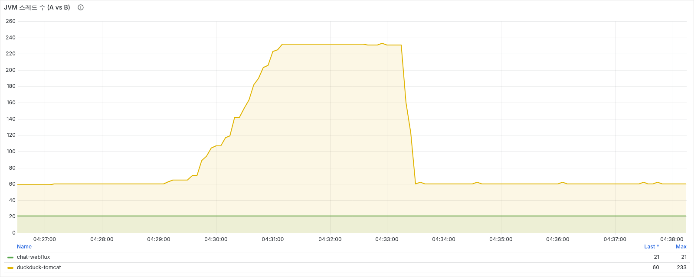
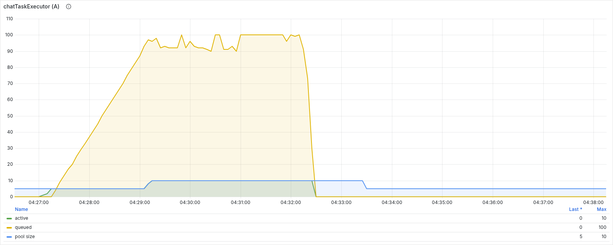

# AI 채팅 부하 테스트 (A: Tomcat vs B: WebFlux)

싱글 모드 AI 채팅을 기존 방식(A, `backend/`)과 분리한 WebFlux 서비스(B, `ai-chat/`)로 각각 띄우고, 같은 자원·같은 시나리오로 비교한 기록이다.

결론부터 적으면 다음과 같다.

- A 는 동시 100명에서 첫 글자 p95 16.2초. B 는 0.71초.
- A 는 800명에서 JVM 스레드 233개, 톰캣 스레드 200개를 모두 쓴다. B 는 끝까지 21개.
- 같은 시간 처리량은 B 가 1.7배. 대신 B 는 800명에서 CPU 85% 로 2 vCPU 한계에 닿는다.

## 1. 왜 측정했나

싱글 모드는 AI 수덕과 1:1 로 한국어 대화를 하고, 대화가 끝나면 쉐도잉 문장을 만든다. 메시지 한 건은 OpenAI 응답을 기다리느라 1초 안팎 걸린다.

기존 구현(A)은 이 1초 동안 스레드 하나를 붙잡는다. 사용자가 늘면 스레드가 먼저 바닥나고, 그 뒤 요청은 줄을 선다. 이 줄이 실제로 얼마나 길어지는지, 같은 계약을 non-blocking 으로 만든 B 와 비교하면 어떤지 숫자로 확인하려고 측정했다.

## 2. 무엇을 비교했나

| | A (기준선) | B (분리 서비스) |
|---|---|---|
| 위치 | `backend/` | `ai-chat/` |
| 서버 | Tomcat (스레드 200) | Netty |
| OpenAI 호출 | `@Async` chatTaskExecutor + RestTemplate | WebClient |
| 스트리밍 응답 | SseEmitter | `Flux<ServerSentEvent>` |
| 쉐도잉 생성 | 같은 chatTaskExecutor 에 작업 제출 | `flatMapSequential` 동시성 4 |
| 세션 저장 | Redis | Redis (같은 키) |
| 인증 | JWT | JWT (같은 비밀키) |

두 앱은 API 계약이 같다. 경로(`/api/v1/ai-chat/sessions`, `/messages`, `/greeting`, `/shadowing`), 요청·응답 형식, Redis 키, JWT 비밀키가 모두 같아서 k6 스크립트는 대상 주소만 바꿔 그대로 쓴다. 토큰은 A 의 `test-login` 에서 받고 B 는 같은 키로 검증한다.

A 의 chatTaskExecutor 설정은 core 5 / max 10 / queue 100, 거부 정책 CallerRunsPolicy 다 (`AiApplicationConfig`).

### 왜 WebFlux 인가

스레드가 바닥나는 원인은 blocking 호출이다. 이것만 보면 톰캣에 WebClient 를 쓰거나 가상 스레드로도 풀린다. 그래도 분리한 서비스를 WebFlux 로 만든 이유는 세 가지다.

1. 프로젝트가 Java 17 이다. 가상 스레드(Java 21)를 쓰려면 업그레이드가 먼저 필요했다.
2. LLM 토큰 스트리밍은 Spring 생태계에서 Flux 로 다루는 것이 일반적이다(Spring AI 등). 요청 수신부터 SSE 응답까지 한 모델로 맞췄다.
3. 분리한 서비스에는 JPA 같은 blocking 의존성이 없다. WebFlux 에 넣어도 안전했고, 톰캣 스레드 풀을 둘 이유가 없었다.

비용은 JVM 프로세스가 하나 더 뜬다는 점이다. 그리고 이 측정이 보여주는 것은 "blocking 구조(A) vs non-blocking 구조(B)"의 차이다. "WebFlux 가 WebClient 나 가상 스레드보다 빠르다"는 결론은 이 측정에서 나오지 않는다.

## 3. 어떻게 측정했나

### 환경

- 로컬 단일 머신(M-series, Docker Desktop 8 CPU / 7.7GB)
- 앱 컨테이너 A·B 에 똑같이 `cpus: "2.0"`, `mem_limit: 1536m`, JVM `-Xmx1g`
- k6 는 컨테이너 밖(호스트)에서 실행. A 와 B 는 따로 측정
- Prometheus 5초 간격 수집, Grafana 대시보드로 확인

### OpenAI 대신 mock

부하 테스트에 실제 OpenAI 를 쓰면 분당 호출 한도와 비용에 먼저 막힌다. 그래서 응답 시간을 고정한 mock(`mock-gpt/`)을 쓴다. 지연값은 실제 gpt-4o-mini 를 20회씩 호출해 잰 중앙값이다 ([results/openai-latency.md](results/openai-latency.md)).

| 항목 | mock 값 | 실측 근거 |
|---|---|---|
| 채팅 첫 토큰 | 700ms | 첫 토큰 median 약 650ms |
| 채팅 토큰 수 / 간격 | 30개 / 10ms | 전체 median 약 950ms |
| 쉐도잉 응답 | 1,300ms | median 약 1.3초 |

즉 B 가 아무리 잘 돌아도 채팅 첫 바이트는 700ms, 쉐도잉은 1,300ms 아래로 내려갈 수 없다. 이 값이 하한선이다.

### 시나리오

| 스크립트 | 한 번의 반복 | 동시 사용자 (각 60초) |
|---|---|---|
| `k6/chat-stream.js` | 세션 생성 → 메시지 1건(SSE 끝까지 수신) → 1초 쉼 | 50 → 100 → 200 → 400 → 800 |
| `k6/shadowing.js` | 세션 생성 → 메시지 2건 → 쉐도잉 생성 → 1초 쉼 | 10 → 20 → 50 → 100 |

### 지표

| 지표 | 어디서 | 무엇을 |
|---|---|---|
| 응답 시간 | k6 | 첫 바이트(`http_req_waiting`) p50/p95/p99, 스트림 끝까지(`http_req_duration`) p95 |
| 처리량 | k6 | 초당 처리한 대화(또는 쉐도잉 전환) 수 |
| 실패율 | k6 | HTTP 실패, `event:done` 수신 여부 |
| 스레드 / 메모리 | Prometheus | JVM 스레드, 톰캣 바쁜 스레드, chatTaskExecutor 활성·큐, 힙, CPU |

## 4. 결과

전체 결과와 원본 파일 목록은 [results/summary.md](results/summary.md) 에 있다. 실패율은 전 구간 0% 다.

### 채팅 스트리밍: 구간별 첫 바이트 (k6)

| 동시 사용자 | A p95 | A p99 | B p95 | B p99 |
|---|---|---|---|---|
| 50 | 7,331ms | 7,788ms | 707ms | 708ms |
| 100 | 16,216ms | 16,445ms | 707ms | 710ms |
| 200 | 14,035ms | 17,224ms | 708ms | 711ms |
| 400 | 10,390ms | 10,893ms | 712ms | 726ms |
| 800 | 2,234ms | 11,405ms | 791ms | 871ms |

### 채팅 스트리밍: 6분 합산과 서버 지표

| | A | B |
|---|---|---|
| 메시지 첫 바이트 p95 / p99 | 10,875 / 13,026ms | 765 / 830ms |
| 메시지 전체 p95 | 11,199ms | 1,094ms |
| 처리한 대화 수 / 초 | 68.3 | 117.0 |
| 세션 생성(Redis 만) p95 | 828ms | 71ms |
| JVM 스레드 | 60 → 233 | 21 (변화 없음) |
| 톰캣 바쁜 스레드 | 800명 구간 200/200 | 해당 없음 |
| chatTaskExecutor | 활성 5 → 10, 큐 100/100 | 해당 없음 |
| 힙 최대 | 273MB | 106MB |
| CPU 최대 | 39% (423 req/s) | 85% (702 req/s) |

### 쉐도잉 전환 (10 → 100명)

| | A | B |
|---|---|---|
| 쉐도잉 p50 / p95 / p99 | 13,475 / 16,303 / 17,136ms | 1,304 / 1,310 / 1,320ms |
| 메시지 첫 바이트 p95 (같은 시간대) | 14,547ms | 708ms |
| 전환 처리 수 / 초 | 1.26 | 7.66 |

### 실제 OpenAI 로 확인 (동시 50 → 100명, 각 60초)

mock 결과가 실제와 맞는지 보려고 진짜 gpt-4o-mini 로 같은 스크립트를 돌렸다.

| | A | B |
|---|---|---|
| 메시지 첫 바이트 p50 / p95 / p99 | 8,058 / 15,441 / 15,864ms | 584 / 784 / 950ms |
| 처리한 대화 수 / 초 | 5.3 | 27.0 |
| 실패 / OpenAI 429 | 0% / 없음 | 0% / 없음 |

mock 의 100명 구간(A 16.2초 / B 0.71초)과 같은 그림이다. 동시 10명에서는 A·B 모두 첫 바이트 p95 1초 안팎으로 차이가 작았다.

### Grafana

아래 캡처는 A 구간과 B 구간이 한 시간축에 이어서 찍혀 있다.



A(노란 선)는 부하가 오르자 60개에서 233개까지 늘고, B(초록 선)는 21개에서 움직이지 않는다.



A 의 pool size(파란 선)는 큐(노란 선)가 100 가까이 찰 때까지 5에 머문다.

## 5. 해석

**A 는 사실상 스레드 5개로 돈다.** chatTaskExecutor 는 max 10 으로 설정돼 있지만, 자바 `ThreadPoolExecutor` 는 큐가 꽉 차기 전에는 core 를 넘겨 스레드를 늘리지 않는다. 큐 100개가 찰 때까지는 5개만 일한다. 메시지 한 건이 1초 넘게 스레드를 잡으니 초당 5건이 상한이고, 나머지는 큐에서 기다린다. 50명에서 이미 p95 7초, 100명에서 16.2초가 나온 이유다. 쉐도잉 생성도 같은 실행기를 쓰기 때문에 채팅과 서로 줄을 세우고, 쉐도잉 p95 는 16.3초까지 늘어난다.

**큐가 차면 톰캣 스레드가 직접 기다린다.** 200명부터는 CallerRunsPolicy 때문에 요청을 받은 톰캣 스레드가 OpenAI 응답을 직접 기다린다. 병렬로 처리되는 수가 늘어 800명 구간 p95 는 2.2초로 줄지만, 톰캣 스레드 200개가 모두 묶인다. p99 는 11초로 남고, OpenAI 와 상관없는 세션 생성까지 p95 828ms 로 밀린다. AI 채팅 하나 때문에 같은 서버의 다른 API 가 함께 느려지는 구조다.

**B 는 스레드 수가 부하와 무관하다.** 800명까지 21개로 고정이고, p95 는 mock 하한 700ms 에 거의 붙어 있다. 쉐도잉은 4문장을 병렬로 호출해 하한 1.3초 근처(p95 1.31초)에 머문다.

**B 의 한계는 CPU 다.** 800명에서 CPU 85% 에 닿으면서 p95 가 791ms 로 오른다. 2 vCPU 제한에서 초당 702 요청을 처리한 결과로, 여기서 더 올리려면 CPU 를 늘리거나 인스턴스를 늘려야 한다. 병목이 스레드 수에서 CPU 로 옮겨 갔다는 것까지가 이 측정에서 말할 수 있는 내용이다.

## 6. 실행 방법

### 준비

```bash
cd bench
cp .env.example .env      # JWT_SECRET 채우기. A·B 가 같은 키를 써야 토큰이 통한다
docker compose up -d --build
docker compose ps         # app-a, app-b, mysql, redis, mock-gpt 가 healthy 인지 확인
```

| 서비스 | 호스트 포트 | 비고 |
|---|---|---|
| app-a (Tomcat) | 18080 | 설정: `config/app-a.yaml`, 이미지: `docker/app-a.Dockerfile` |
| app-b (WebFlux) | 18081 | 설정: 환경변수, 이미지: `ai-chat/Dockerfile` |
| mock-gpt | 19000 | `/stats`, `/metrics`, `POST /reset` |
| Prometheus | 9090 | 5초 간격 수집 |
| Grafana | 3000 | 로그인 없음. http://localhost:3000/d/ai-chat-bench |
| mysql, redis | 내부 전용 | 로컬 개발용 8080/8081/6379 와 겹치지 않는다 |

자원 제한 적용 확인:

```bash
docker inspect sudaduck-bench-app-a-1 --format '{{.HostConfig.NanoCpus}} {{.HostConfig.Memory}}'
# 2000000000 1610612736
```

### 부하 테스트

```bash
./run.sh a chat                     # A, 채팅 스트리밍 (기본 50→100→200→400→800 VU, 각 60초)
./run.sh b chat                     # B, 같은 시나리오
./run.sh a shadowing                # A, 메시지 2번 + 쉐도잉 생성 (기본 10→20→50→100 VU)
./run.sh b shadowing my-label       # 세 번째 인자는 결과 파일 라벨

STAGES=10:30s,0:5s ./run.sh a chat smoke-a                       # 단계 덮어쓰기 (VU:시간, 마지막에 0 으로 내리기)
K6_EXTRA="--out csv=results/full2-a-chat.csv.gz" ./run.sh a chat full2-a   # 구간별 분석용 시계열도 남기기
```

- `run.sh` 는 시작 전에 mock 카운터를 비우고(`POST /reset`), 끝나면 mock `/stats` 를 출력한다.
- 토큰은 항상 A 의 `test-signup`/`test-login` 으로 받는다. B 는 같은 JWT 키로 검증한다.
- 한 번에 한 앱만 테스트한다. 두 앱은 같이 떠 있어도 대기 중에는 자원을 거의 안 쓴다.
- 실패율 1% 미만, checks 99% 이상은 정보용 임계값이다. 넘겨도 테스트는 끝까지 돌고 `run.sh` 는 성공으로 끝난다.

### 구간별 표 만들기

k6 요약은 전체 합산이라 동시 사용자 구간별로 다시 자른다.

```bash
# 손님(k6) 쪽: CSV 시계열을 구간별로 → results/<label>-chat-k6-per-stage.md
python3 k6-per-stage.py results/full2-a-chat.csv.gz

# 서버 쪽: Prometheus 지표를 구간별로 → results/<label>-<scenario>-per-stage.md
python3 per-stage.py full-a a
python3 per-stage.py full-b b
```

### 결과 파일

`results/` 에 라벨별로 남는다.

- `<label>-<chat|shadowing>-summary.txt`: 요청 이름별 p50/p95/p99 표
  - `wait` = `http_req_waiting` (첫 바이트까지), `dur` = `http_req_duration` (SSE 끝까지)
- `<label>-<chat|shadowing>-summary.json`: 위 표 + k6 원본 요약
- `<label>-<chat|shadowing>-k6-export.json`: `--summary-export` 결과
- `summary.md`: 위 결과를 정리한 문서
- `grafana/*.png`: Grafana 패널 캡처

### mock 지연값 바꾸기 / 다시 재기

mock 값은 `docker-compose.yml` 의 `FIRST_TOKEN_MS`, `TOKEN_COUNT`, `TOKEN_INTERVAL_MS`, `SCRIPT_MS` 로 바꾼다. 실제 OpenAI 지연을 다시 재려면:

```bash
python3 measure-openai.py --n 10    # OPENAI_API_KEY 환경변수 또는 ../ai-chat/.env 에서 읽음
```

### 초기화 / 정리

```bash
curl -X POST localhost:19000/reset     # mock 카운터만 초기화
docker compose restart app-a app-b     # 앱 상태(스레드, 힙) 초기화
docker compose down                    # 전체 종료 (Prometheus 데이터는 볼륨에 남는다)
docker compose down -v                 # 볼륨까지 삭제
```

## 7. 한계와 주의

- **mock 이다.** OpenAI 응답 시간을 중앙값 하나로 고정했다. 실제로는 응답이 들쭉날쭉하고, 분당 호출 한도(429)도 있다. 실제 API 로는 동시 100명까지만 확인했고 그 이상은 mock 결과로 본다.
- **로컬 단일 머신이다.** k6, 앱, Redis, mock 이 한 머신의 CPU 를 나눠 쓴다. 절대값보다 같은 조건에서 A 와 B 의 차이로 읽어야 한다. EC2 같은 운영 환경 숫자는 아니다.
- **서버 지표에는 접속 대기열이 안 보인다.** 서버 쪽 응답 시간은 톰캣이 요청을 집어든 뒤부터만 잰다. 800명 구간에서 톰캣 스레드 200개가 모두 바쁠 때 연결이 accept 대기열에서 기다린 시간은 빠진다. 그래서 구간 비교는 손님 쪽(k6) 숫자를 쓴다.
- **macOS 접속 대기열 크기.** k6 는 호스트(macOS)에서 Docker Desktop 의 포트 포워딩을 거쳐 접속한다. macOS 의 `kern.ipc.somaxconn` 기본값은 128 이고(`sysctl kern.ipc.somaxconn` 로 확인), 동시 연결이 이보다 훨씬 많을 때는 호스트 쪽 대기열도 지연에 섞일 수 있다. 이번 측정의 실패율은 0% 였지만, 더 높은 동시 사용자로 재현할 때는 이 값을 확인하는 것이 좋다.
- **A 의 숫자는 A 의 설정에 묶여 있다.** core 를 늘리면 A 의 숫자도 달라진다. 다만 스레드 수만큼만 동시 처리한다는 구조는 그대로다.
